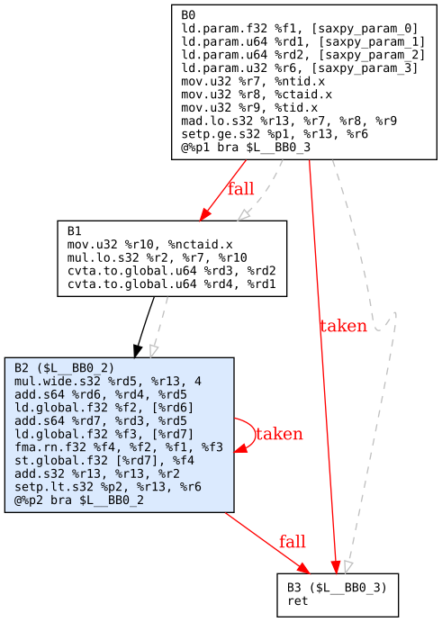

# ptx-opt — a PTX analyser and mini optimiser (C++17)

`ptx-opt` reads NVIDIA **PTX** (the virtual ISA that `nvcc` emits and that `ptxas` / the driver turn into SASS),
builds a control-flow graph, runs dataflow analyses, applies a small optimisation pipeline, and — the part that
makes it trustworthy — **proves the optimised code still computes the same thing** by running both versions in a
built-in interpreter on random inputs (differential testing + a random-program fuzzer).

```
 .ptx text ──► lexer ──► parser ──► IR (functions, instrs, regs)
                                      │
              ┌───────────────────────┼─────────────────────────┐
              ▼                       ▼                         ▼
        CFG + dominators        liveness dataflow         optimisation passes
        + post-dominators       (backward, bitsets)       constfold · copyprop · cse
        + natural loops              │                    simplify · branch · dce
              │                      ├─► register pressure        │
              ├─► Graphviz .dot      └─► divergence analysis      ▼
              ▼                                            optimised .ptx
        loops / divergent branches                              │
                                                                ▼
                                   interpreter: original vs optimised on random inputs
```

Example output of `ptx-opt cfg --dom` (loop header shaded blue, divergent branches red, dashed grey = dominator tree):



## 1. What you need

| Requirement | Needed for | Notes |
|---|---|---|
| **g++ ≥ 9** (or clang++), C++17 | building | `sudo apt install g++ make` (Ubuntu/WSL) · `xcode-select --install` (macOS) |
| **make** | building | |
| **Graphviz** (`dot`) | CFG pictures only | `sudo apt install graphviz` · `brew install graphviz` |
| **CUDA toolkit** (`nvcc`) | generating *real* PTX from `kernels/*.cu` | optional — **no GPU needed** for `nvcc -ptx` |
| **An NVIDIA GPU** | `make gpu-verify` only | optional — free option: Google Colab (T4) |

Everything else (analysis, optimisation, differential tests, fuzzing) runs on any Linux/macOS/WSL machine with
just a compiler. There are **no external libraries** and no test framework to install.
Windows users: use WSL2 (Ubuntu) — it is the easiest route.

## 2. Build and run — step by step

```bash
# 1. get into the project
cd ptx-opt

# 2. build the tool
make                      # -> build/ptx-opt

# 3. run the test-suite (≈1,280 checks incl. 400 fuzzed programs; takes a few seconds)
make test                 # all green = 0 failed

# 4. analyse a kernel
./build/ptx-opt analyze samples/saxpy_loop.ptx

# 5. optimise one, see what changed, and prove it is still correct
./build/ptx-opt optimize samples/redundant.ptx -o out/redundant.opt.ptx --stats --verify

# 6. draw the control-flow graph
./build/ptx-opt cfg samples/saxpy_loop.ptx --out out/cfg --dom
dot -Tpng out/cfg/saxpy.dot -o out/cfg/saxpy.png

# or do everything above for all samples:
scripts/demo.sh
```

Expected result of step 5 (real output):

```
== redundant
  instructions : 43 -> 24  (44% fewer)
  basic blocks : 5 -> 3
  reg pressure : 11 -> 8 x 32-bit slots, 1 -> 1 predicates (peak live, estimated)
  verify redundant: PASS (20 random trials x 64 threads, memory identical)
```

### Using real compiler output (recommended before an interview)

The files in `samples/` are hand-written in nvcc's style so the project works anywhere. To use genuine PTX:

```bash
scripts/gen_ptx.sh sm_75          # needs nvcc; writes generated/<kernel>.ptx and generated/<kernel>_O0.ptx
./build/ptx-opt analyze  generated/vecadd.ptx
./build/ptx-opt optimize generated/vecadd_O0.ptx --stats --verify -o out/vecadd_O0.opt.ptx
```

Or without installing anything: open a **Google Colab** GPU notebook and run
`!nvcc -ptx -O3 -arch=sm_75 kernels/vecadd.cu -o vecadd.ptx`, then download the `.ptx`.
Anything the tool cannot understand is **kept verbatim and reported**, never silently altered.

### Optional: verify on a real GPU

```bash
export CUDA_HOME=/usr/local/cuda
scripts/gpu_compare.sh samples/vecadd_O0.ptx vecAdd     # kernels: vecAdd | saxpy | redundant | divergent
# RESULT: identical output on the real GPU
```
This loads original and optimised PTX through the CUDA **driver API** (so the driver JIT-compiles PTX→SASS,
the same path real applications use) and compares output checksums. *Note: this harness was only
syntax-checked against a stub header while developing — it has not been run on a GPU yet. Treat the first run
as part of your own validation, and report what you find honestly.*

## 3. Commands

| Command | What it does |
|---|---|
| `ptx-opt analyze f.ptx [--json]` | per function: blocks, edges, loops (header/latch), peak register pressure, divergent branches, opcode histogram, warnings |
| `ptx-opt cfg f.ptx --out dir [--dom]` | one `.dot` per function; loop headers shaded, divergent branches red, `--dom` adds dominator-tree edges |
| `ptx-opt optimize f.ptx [-o out] [--passes=a,b] [--stats] [--verify[=N]] [--max-iter=N]` | run the pipeline to a fixed point; `--verify` differential-tests every function |
| `ptx-opt verify a.ptx b.ptx [--trials=N]` | differential-test two PTX files against each other (same function names) |
| `ptx-opt passes` | list passes |

Exit code `2` means a verification **FAIL** (so it can gate CI).

## 4. What each part does

**Parser** (`lexer.cpp`, `parser.cpp`): hand-written lexer + recursive-descent parser for a practical PTX subset —
`.reg` ranges (`%r<40>`), predicates and `@!%p` guards, `[%rd1+8]` memory operands, vectors `{a,b}`, `setp` pairs,
`.loc`/`.file` (no `;`), labels, `.shared/.local` declarations. Anything unparseable becomes an **opaque**
instruction; functions with nested `{ }` scopes (inline asm) or `brx.idx` are kept **verbatim**.

**CFG** (`cfg.cpp`): basic blocks, edges (guarded `bra` = two successors), reachability, dominators and
post-dominators (Cooper–Harvey–Kennedy), natural loops from back edges, loop depth.

**Liveness** (`dataflow.cpp`): backward dataflow with bitsets. A *guarded* definition does **not** kill a register
(the old value may survive) — a classic subtle point that the fuzzer verifies.

**Register pressure** (`analysis.cpp`): peak live 32-bit slots (64-bit values count 2) and live predicates.
This is an *estimate*; `ptxas` does its own allocation, so compare against `ptxas -v` for real numbers.

**Divergence** (`analysis.cpp`): taint analysis from `%tid.*`/`%laneid` through data dependences, plus control
dependence via post-dominators (a value assigned under a divergent branch is itself varying). A conditional
branch on a varying predicate is reported as *potentially* divergent (a warp may split).

**Passes** (`passes.cpp`) — run repeatedly until nothing changes:
`constfold` (constants, folded guards, signed/unsigned/width-correct) · `copyprop` (block-local + single-definition
global) · `cse` (block-local, commutative-aware) · `simplify` (x+0, x·1, x·2ᵏ→shl, u/2ᵏ→shr, u%2ᵏ→and, self-moves) ·
`branch` (jump threading, branch-to-next, unreachable blocks, unused labels) · `dce` (liveness-based).
Side-effecting instructions (`st`, `atom`, `bar`, volatile loads, opaque ops) are never removed or reordered.

**Interpreter + differential tester** (`interp.cpp`): executes one thread at a time (integer/float ALU,
predicates, branches, `ld/st`, `ld.param`) over 2 blocks × 32 threads with random parameters and memory, then
compares final memory byte-for-byte.

## 5. How it was validated (be ready to explain this)

* **Unit tests** for lexer, parser round-trip, each pass, CFG/loops/dominators, liveness, divergence.
* **Idempotence**: optimising already-optimised output changes nothing.
* **Fuzzer**: 400 random programs (arithmetic, shifts, div/rem, predicated writes, forward branches) are
  optimised and differential-tested.
* **Mutation testing** — I deliberately injected bugs into the passes to check that the fuzzer notices. It caught
  every real one (e.g. wrong constant folding, wrong shift amount, copy propagation that forgets to invalidate on
  redefinition, "guarded def kills liveness", CSE of `x = x + 1`). Mutants that are *semantically harmless*
  (e.g. disabling CSE) correctly stayed green. An early version of the fuzzer missed one mutant (guarded defs
  killing liveness in the block summary) — that is how the "predicated overwrite" case was added to the generator.

## 6. Honest limitations

* Not a full PTX front end: no `call`/`.func` bodies with nested scopes, no `brx.idx`, tensor-core (`mma`, `wmma`),
  `cp.async` etc. Those are treated as opaque or skipped — never altered.
* The interpreter is single-thread-at-a-time: no cross-thread effects, so `bar.sync`, shared-memory communication,
  `atom`, `shfl`, `vote` cannot be verified (the tool says `SKIP` and why). Floating-point is computed in
  `double` and rounded, so it may differ from hardware in the last bit for transcendental ops.
* Passes are intra-block (CSE, local copy-prop) or conservative-global. There is no loop-invariant code motion,
  unrolling, or instruction scheduling.
* Register pressure is a liveness estimate, not what `ptxas` allocates. Divergence is a conservative static
  approximation (it can over-report, and treats `%tid.y/z` like `%tid.x`).
* `samples/*.ptx` are hand-written in nvcc style, not copied from a specific nvcc version. Use
  `scripts/gen_ptx.sh` for genuine output.
* The CUDA driver harness (`verify/run_ptx.cpp`) has not been run on a GPU.

## 7. Layout

```
include/ptxopt/*.h   public headers          src/*.cpp        implementation + main.cpp (CLI)
tests/test_main.cpp  tests + fuzzer          samples/*.ptx    PTX inputs (nvcc-style)
kernels/*.cu         CUDA sources            scripts/         demo.sh, gen_ptx.sh, gpu_compare.sh
verify/run_ptx.cpp   optional GPU checker     docs/            sample CFG picture
```

## 8. Ideas to extend it (good talking points)

1. Loop-invariant code motion using the loop info already computed (needs dominators + side-effect check).
2. Compare predicted register pressure to `ptxas -v` ("Used N registers") across `kernels/` and plot the error.
3. A `ld.global` redundancy pass guarded by alias analysis between `st`/`ld`.
4. Model `bar.sync` in the interpreter by running a whole block in lock-step.
5. Emit LLVM-IR-style SSA (phi insertion on dominance frontiers) as a second IR.

## 9. Resume lines (adjust to what you actually do)

* Built **ptx-opt**, a C++17 analyser/optimiser for NVIDIA PTX: parser, CFG with dominators/post-dominators and
  natural-loop detection, liveness-based register-pressure and warp-divergence analyses, and six optimisation
  passes (const-fold, copy-prop, CSE, peephole/strength reduction, branch simplification, DCE).
* Validated correctness with a built-in PTX interpreter: differential testing, a 400-program random fuzzer, and
  mutation testing of the optimiser; cut instruction count by up to 44% on redundant kernels (all verified).
